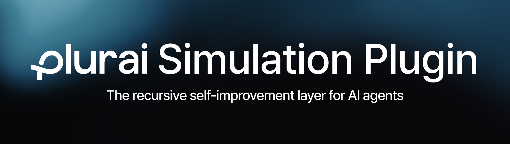
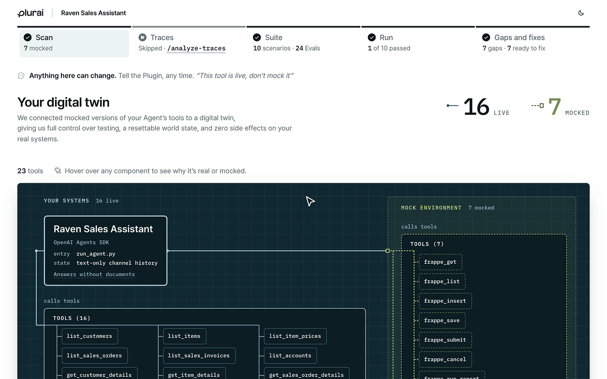

<h1 align="center">
  
</h1>

<div align="center">

[](https://discord.gg/bg34gh76uJ)
[](#install)

[Documentation](https://docs.plurai.ai/) |
[Quick Start](#quickstart) |
[Plurai](https://plurai.ai)

</div>

Set up Plurai simulation for any AI agent in minutes. This plugin analyzes your agent's code, identifies production dependencies, and generates a `simulate.py` wrapper that lets you test your agent against simulated scenarios without production infrastructure.

## Install

Add the public Plurai marketplace, then install the plugin:

```bash
/plugin marketplace add plurai-ai/plurai-plugins
/plugin install plurai-simulation@plurai-plugins
```

### First run

Start Claude Code from your agent's folder, then run `/simulate`:

```bash
cd <your agent>
claude
```

The overview page opens in your browser and updates live during the run. On Claude Code, you get a private link to it at the end.
Start from your agent's folder or any folder above it; from anywhere else, the page stays on your machine and no link is
published.

Claude Code asks before reading the plugin's own files, because they are installed outside your project:

- **Auto mode:** choose `Yes, and keep allowing any reads outside the working directories`. It won't ask again.
- **Default mode:** choose `Yes, allow reading from <folder> during this session`. It asks once per skill in each session.

For an unattended or CI run, see [Unattended and CI runs](docs/unattended-runs.md).

Using another coding agent or Windows? See the [Copilot CLI](docs/install-copilot-cli.md) (beta),
[Codex CLI](docs/install-codex-cli.md) (beta) or [Windows](docs/install-windows.md) guide.

## Quickstart

1. **Sign in.** There is nothing to run: the first Plurai command signs you in. With no login saved, it installs the SDK the
   plugin was tested with when it is missing (it asks first) and runs the SDK's `plurai login`, which opens the browser:
   you sign in or sign up there, pick your organization and approve. The SDK creates its own key and saves it; the key is
   never shown, typed or copied.

   No browser on this machine? See [Sign in without a browser](docs/sign-in-without-a-browser.md).
2. **Run your first simulation.** From the project that holds your agent:

   ```bash
   /simulate <path to your agent>
   ```

   `/simulate` scans the agent, installs the SDK the plugin was tested with, builds the suite, runs it and writes the fix
   plan. [What you can do](#what-you-can-do) lists each stage as a command of its own.

## Supported environments

- **Coding agents.** Claude Code. Codex CLI (beta). Copilot CLI (beta).
- **Operating systems.** macOS and Linux. Windows (PowerShell, no WSL) is supported with Git for Windows and a
  python.org Python; [docs/install-windows.md](docs/install-windows.md) is the install guide. Agents that need the Node
  bridge are not supported on Windows. Codex on Windows follows Codex's documented hook shell (`cmd.exe`) and is not run in
  the plugin's CI.
- **Python.** Python 3.12 or newer for the SDK the plugin installs into your project's environment, and a `python3` on
  the PATH for the plugin's own hooks and scripts. An agent written in Node also needs Node 22.15 or newer
  ([Agents in other runtimes](docs/agents-in-other-runtimes.md)).

## Watch your simulation live

Everything from a run comes together in one page: `plurai_sim/artifacts/report.html`, beside your agent's code
(`plurai_sim/envs/<name>/artifacts/report.html` when you use a named environment).



For every other file and folder, see [What the plugin writes](docs/what-the-plugin-writes.md).

## What you can do

```bash
/simulate <path to your agent>
```

`/simulate` runs the whole simulation end to end — scan the agent, build the suite, run it, and
write the fix plan — asking at the start only what it cannot decide for you (such as whether to connect a
trace source, whether to remove personal data before uploading, and on a repeat run what this run should do). Each stage ends with its summary in
chat. The overview page opens in your browser when the run starts and updates live as it goes; the private link to it
comes once, at the end of the run (when it finishes, halts, or you stop it), and it is the same link on every later run of the
project. To change anything,
say so in chat at any point (the map, the mocked world, the scenarios, an eval, the run, the fix
plan) and the flow redoes that stage and everything after it.

Each stage is also a command you can run alone — each produces what the next one consumes:

```bash
/simulation-scan-agent <path to your agent>    # 1. scan   — map the agent, write its simulate.py
/analyze-traces                                 # 2. traces — (optional) ground the sim in real production traces
/simulation-generate-suite                      # 3. suite  — stand up the mocked world + knowledge corpus, generate scenarios + evals, render a report
/simulation-run                                 # 4. run    — a simulated user plays each scenario; score all evals
/simulation-fixes                               # 5. fixes  — diagnose failures, propose an evidence-backed fix plan
```

`/analyze-traces` (step 2) is optional — use it when you have real production
traces and want the mock, scenarios, and evals grounded in real behavior.

You can also just describe what you want in natural language — e.g.
"Set up Plurai simulation for my agent in `<path to your agent>`" routes to the
scan command.

### Ask for it in chat

Ask in chat, and the plugin does it:

🧪 **Generate more scenarios.** Add scenarios, or steer which kinds get generated.

🎯 **Correct a scenario.** Fix a wrong expected answer.

⚖️ **Change the evals.** Add, change or remove an eval, or improve one that judges poorly.

🌍 **Change the mocked world.** Change what a tool returns, seed different data, or fix a stale fact.

🔁 **Replay real conversations.** Turn production conversations into scenarios that resume where they ended, and record a confirmed issue as a regression that replays its conversation and measures how often it comes back.

🔎 **Analyze production traces.** Ground the simulation in real traces and turn their failures into scenarios. For a trace format the plugin doesn't know yet, it can write an adapter.

📚 **Test RAG and SQL tools.** Build a knowledge corpus for each tool, so answers are checked against your own content.

📦 **Use your own records.** Upload a bundle of real records to base scenarios on. Only the records you pick are uploaded.

📄 **Generate realistic documents.** Upload example invoices, forms, tickets or PDFs, so generated documents follow your real formatting.

✨ **Improve the simulation's quality.** Independent reviewers find the weakest scenarios, evals and mocks, and the plugin fixes them.

💾 **Save and switch environments.** Keep named setups and move between them.

📊 **Log runs to your observability platform.** Record runs in LangSmith, Langfuse, Arize or Braintrust.

Most of these also have a command of their own: see [Other commands](docs/other-commands.md).

## How it works, without touching your code

1. **Reads your agent code** — follows all imports, identifies the graph, tools, checkpointer, and production dependencies
2. **Generates `simulate.py`** — stubs production deps (MagicMock), replaces context-loading nodes with scenario-backed versions, swaps ToolNode with `plurai.MockToolNode` for tool interception, compiles with `MemorySaver`
3. **Generates `plurai.config.yaml`** — lists all tools with mock/real mode and descriptions

It doesn't modify your agent's source code, require refactoring or dependency injection, or add decorators to your
tools. Everything happens in the generated `simulate.py`, and your production code stays untouched.

## Supported frameworks

**Python**

- LangGraph (primary)
- Claude Agent SDK (the Claude Code SDK)
- Google ADK
- CrewAI
- OpenAI Agents SDK
- LlamaIndex
- Strands Agents
- LangChain chains
- Custom agents with no framework, such as a plain OpenAI or LiteLLM tool loop

**Node (TypeScript or JavaScript)**

- Mastra
- Vercel AI SDK
- LangGraph.js
- OpenAI Agents JS
- Custom loops

[Agents in other runtimes](docs/agents-in-other-runtimes.md) has what these need.

**Agent platforms**

- Salesforce Agentforce
- n8n
- Claude Code plugin commands and skills

## Simulation Environments

Save your mocked world, scenarios and evals as a named environment you can commit, and switch between several, for
example one per component you test. Just ask in chat: _"save this as env `billing`"_, _"switch to env `billing`"_ or
_"list envs"_. See [Simulation Environments](docs/environments.md) for what is saved and what to commit.

## Spend and credits

Your usage, credits and spend are in the [Plurai dashboard](https://simulation.plurai.ai). The plugin never shows cost or credit figures, and the SDK
does not either.

## Getting help

To reach the Plurai team directly, write to support@plurai.ai or join the [Plurai Discord](https://discord.gg/bg34gh76uJ).
A failure that needs a closer look from the team points you to the same two channels.

Something not working? See [Troubleshooting](docs/troubleshooting.md).

## License

The plugin is proprietary software, provided under the terms in [LICENSE](LICENSE). It is not open source, and all rights
not granted there are reserved. You may use it with your Plurai account to test your own agents. You may not copy,
modify, redistribute or reuse it, or use it to build a competing product. The files it generates for you stay yours.

What the plugin uploads, how you control it and what it keeps on your machine are in
[Data & privacy](docs/data-and-privacy.md).
